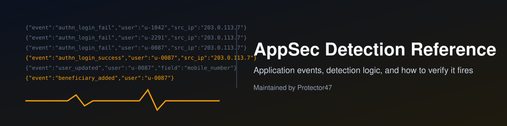

<p align="center">
  
</p>

# AppSec Detection Reference

[](https://github.com/Protector47/appsec-detection-reference/actions/workflows/ci.yml)
[](LICENSE)

Application layer attacks rarely show up in network telemetry. Credential stuffing, object level authorization probing, MFA fatigue, and account takeover chains all look like normal HTTPS from the outside. The application is the only component that knows a login failed, a policy denied an object, or a beneficiary was added five minutes after the mobile number changed.

This repo is the reference I use when working with service teams and the SOC on that gap. It covers three things:

1. **What the application must log**, with a JSON schema and a list of fields you must never log.
2. **What to detect**, as a catalog of detections with logic, starting thresholds, false positives, and response. Fifteen of them ship as Sigma rules.
3. **How to prove a detection fires**, with synthetic event scenarios and a replay test that runs in CI.

It is written for defenders who own the applications and the SIEM. Examples come from digital banking, but most of it applies to any app with logins and sensitive actions.

## What is inside

| Doc | What you get |
| --- | --- |
| [docs/01-logging-baseline.md](docs/01-logging-baseline.md) | Minimum security event set, required fields, never log list, service self check |
| [docs/02-authentication-and-session.md](docs/02-authentication-and-session.md) | Credential stuffing, spray, brute force, MFA fatigue, token reuse, session hijack |
| [docs/03-authorization-and-api.md](docs/03-authorization-and-api.md) | Authz failure spikes, object level probing, cross tenant access, admin routes, mass assignment, scraping |
| [docs/04-business-logic.md](docs/04-business-logic.md) | New beneficiary then transfer, contact change chains, limit drain, idempotency conflicts, promo abuse |
| [docs/05-input-and-platform.md](docs/05-input-and-platform.md) | Validation spikes, parser errors, WAF bypass signals, insider lookups, config changes, log silence |
| [docs/06-verification.md](docs/06-verification.md) | Three layers of verification: rule logic in CI, SIEM pipeline, end to end in UAT |
| [docs/07-tuning-and-response.md](docs/07-tuning-and-response.md) | Report only period, exclusions, severity, ownership, safe automated responses, metrics |

Supporting material:

- [schema/security-event.schema.json](schema/security-event.schema.json) is the event schema. Use it to validate what your services emit.
- [rules/sigma/](rules/sigma/) has the Sigma rules, including correlation rules for thresholds and sequences.
- [examples/events/](examples/events/) has 22 synthetic scenarios (documentation IP ranges, fake users) for replay into a test index.
- [templates/](templates/) has a detection spec and a detection test record.

## Detection catalog

| ID | Detection | Sigma |
| --- | --- | --- |
| DET-AUTH-01 | Credential stuffing from one source | yes |
| DET-AUTH-02 | Distributed credential stuffing | SIEM baseline |
| DET-AUTH-03 | Password spray | yes |
| DET-AUTH-04 | Brute force on one account | |
| DET-AUTH-05 | Success after a failure burst | |
| DET-AUTH-06 | MFA push fatigue | yes |
| DET-AUTH-07 | MFA method changed then sensitive action | |
| DET-AUTH-08 | Password reset flood | |
| DET-AUTH-09 | Refresh token reuse | yes |
| DET-SESS-01 | Session context change | yes |
| DET-SESS-02 | Use after logout or expiry | |
| DET-AUTHZ-01 | Authorization failure spike | yes |
| DET-AUTHZ-02 | Object level authorization probe | yes |
| DET-AUTHZ-03 | Cross tenant access attempt | |
| DET-AUTHZ-04 | Privileged route used by non privileged role | yes |
| DET-AUTHZ-05 | Privileged role granted | yes |
| DET-API-01 | Mass assignment attempts | |
| DET-API-02 | API key used from unexpected network | |
| DET-API-03 | Scraping and bulk enumeration | |
| DET-API-04 | Unknown or retired endpoint traffic | |
| DET-BIZ-01 | New beneficiary then high value transfer | yes |
| DET-BIZ-02 | Contact detail change then sensitive action | |
| DET-BIZ-03 | Limit raised then drained | |
| DET-BIZ-04 | Transfers just below a control threshold | |
| DET-BIZ-05 | Idempotency key conflict | yes |
| DET-BIZ-06 | Tampered amount values | |
| DET-BIZ-07 | Promotion redemption velocity | |
| DET-INPUT-01 | Validation failure spike | yes |
| DET-INPUT-02 | Parser and template errors | yes |
| DET-INPUT-03 | WAF block then success on same route | |
| DET-DATA-02 | Staff access without a reason | yes |
| DET-PLAT-01 | Security config change | yes |
| DET-PLAT-02 | Security log silence | SIEM baseline |
| DET-PLAT-03 | Unexpected restarts | |

## Quick start

```bash
git clone https://github.com/Protector47/appsec-detection-reference.git
cd appsec-detection-reference
python3 -m venv .venv && . .venv/bin/activate
pip install -r requirements.txt

python scripts/generate_events.py
python scripts/validate_events.py
sigma check rules/sigma/
python scripts/test_rules.py
```

`test_rules.py` replays every scenario through every rule and prints which detections fired. It fails if a rule misses its scenario or fires on one it should ignore.

## How to roll it out

1. Pick one internet facing service with logins. Get it emitting the minimum event set from the logging baseline, validated against the schema.
2. Turn on DET-AUTH-01, DET-AUTH-06, DET-AUTH-09, and DET-PLAT-02 in report only mode. They are cheap and rarely noisy.
3. Add the authorization events. Most teams log a 403 without the resource or owner, and DET-AUTHZ-02 is useless until that changes.
4. Sit with the fraud team before enabling any DET-BIZ rule. Agree who responds and how customers are contacted.
5. Replay the scenarios into your SIEM test index monthly. A rule that worked last quarter can break silently after a logging library upgrade.

## Related

- [appsec-hardening-checklist](https://github.com/Protector47/appsec-hardening-checklist) for the preventive controls these detections back up.
- [secure-design-review-playbook](https://github.com/Protector47/secure-design-review-playbook) for threat modeling, where most of these detections should first be requested.
- [secure-sdlc-playbook](https://github.com/Protector47/secure-sdlc-playbook) for the gates that make logging requirements part of every release.

## Contributing

Field tested thresholds, new detections, and SIEM pipeline examples are welcome. See [CONTRIBUTING.md](CONTRIBUTING.md).

## License

MIT. See [LICENSE](LICENSE).

---

Maintained by [Protector47](https://github.com/Protector47) | <https://www.protector47.com/>
